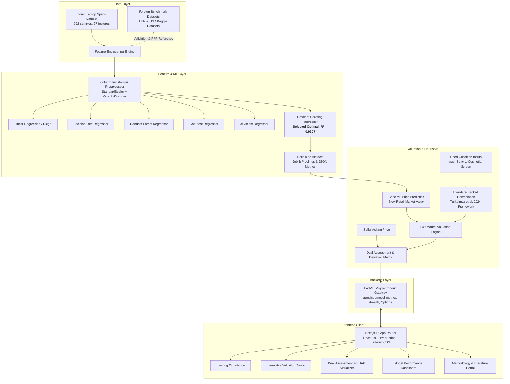
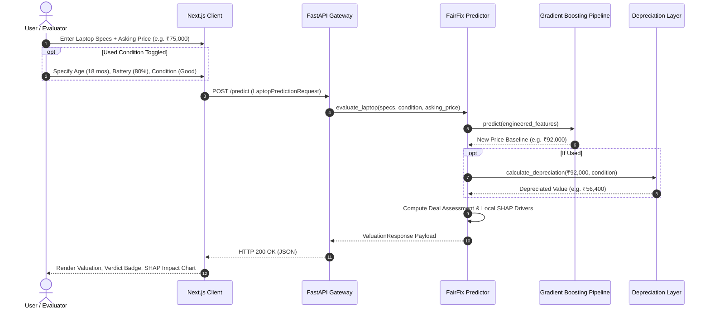

# FAIRFIX — System Architecture & Engineering Design

**Project Title:** ML-Based Price Intelligence and Valuation for Used and Out-of-Warranty Laptops  
**Degree / Academic Focus:** University B.Tech Computer Science and Engineering  
**Version:** 1.0.0 (Production Release)

---

## 1. High-Level Architectural Overview

FairFix is an end-to-end Machine Learning intelligence platform designed to address information asymmetry in consumer electronics markets. It combines genuine machine learning regression models trained on modern hardware specifications with an empirical second-hand depreciation layer, exposed through an asynchronous FastAPI backend and an interactive Next.js interface.

---

## 2. Core Subsystems

### 2.1 Data Ingestion & Preprocessing Subsystem (`ml/data/`, `ml/features/`)
- **Ingestion:** Consumes the primary Indian Laptop Specifications Dataset (`abhinavflac/laptops-specs-dataset`).
- **Domain Feature Engineering:**
  - `cpu_generation`: Parses architecture and generation (Intel 10th-14th Gen, Intel Core Ultra 1 & 2, AMD Ryzen 5000-9000, Apple M1-M4).
  - `display_metrics`: Computes total resolution pixels ($W \times H$), Pixel Density ($PPI = \frac{\sqrt{W^2 + H^2}}{\text{diagonal}}$), and aspect ratio ($W / H$).
  - `gpu_normalization`: Standardizes dedicated vs integrated GPUs, fills physical zero VRAM for integrated shared graphics, and isolates RTX/Iris/Arc/Radeon families.
  - `hardware_ratios`: Evaluates memory-to-storage ratios and thread-to-core hyperthreading factors.
  - `model_family_grouping`: Extracts product chassis series (e.g., `lenovo_ideapad_slim_3`, `asus_tuf_gaming`) to enable strict GroupKFold cross-validation.
- **Preprocessor Pipeline:** Uses Scikit-Learn's `ColumnTransformer` applying zero-leakage `StandardScaler` to continuous numeric columns and `OneHotEncoder(handle_unknown='ignore')` to nominal categorical variables.

### 2.2 Model Training & Validation Subsystem (`ml/models/`, `ml/training/`)
- **Strict Split Configuration:** Enforces an 80% train split ($n=793$) and a 20% test split ($n=199$) with a fixed random seed (`seed=42`).
- **Dual Validation Strategy:**
  1. *Standard 5-Fold Cross-Validation (KFold):* Measures general in-distribution fit and parameter stability.
  2. *Chassis-Grouped Cross-Validation (GroupKFold):* Withholds complete product chassis series from training folds, evaluating generalization to completely novel chassis designs and verifying no data leakage from sibling configurations.
- **Model Catalog:** Compares Linear Regression, Ridge, Decision Tree, Random Forest, XGBoost, CatBoost, and Gradient Boosting.
- **Selection Strategy:** Evaluates composite generalization ($CV\ R^2$, Test $R^2$, and Test $MAE$). Gradient Boosting won with Test $R^2 = 0.9307$, Test $MAE = \text{₹}11,230$, $CV\ R^2 = 0.9256$, and $GroupKFold\ R^2 = 0.8738$.

### 2.3 Used-Laptop Valuation & Depreciation Layer (`ml/predict.py`)
- **Theoretical Basis:** Implements the remanufacturing life-cycle depreciation framework outlined by **Turkolmez et al. (2024)** (*Information Systems Frontiers*).
- **Mathematical Formulation:**
  $$\text{Valuation}_{\text{used}} = \text{Price}_{\text{new}} \times (1 - \delta_{\text{total}})$$
  Where:
  $$\delta_{\text{total}} = \min(0.85, \, \delta_{\text{age}} + \delta_{\text{battery}} + \delta_{\text{cosmetic}} + \delta_{\text{screen}} - \beta_{\text{warranty}})$$
  - $\delta_{\text{age}} = 1 - (1 - 0.22)^{(\text{months} / 12)}$ (capped at 0.75)
  - $\delta_{\text{battery}} \in [0.0, 0.20]$ based on battery health percentage
  - $\delta_{\text{cosmetic}} \in [0.02, 0.28]$ based on physical grade (like-new, good, fair, poor)
  - $\delta_{\text{screen}} \in [0.0, 0.25]$ based on panel blemishes and dead pixel count
  - $\beta_{\text{warranty}} = 0.06$ for active manufacturer warranty
- **Explicit Labeling:** Labeled explicitly as an **Experimental Heuristic** across API responses and frontend views to preserve academic integrity.

### 2.4 Asynchronous Backend API (`backend/`)
- **Framework:** Python 3.11 with FastAPI and Uvicorn.
- **Endpoints:**
  - `GET /health`: Service health, loaded model slug, and empirical $R^2$.
  - `GET /model-metrics`: Full telemetry payload containing comparison tables, KFold vs GroupKFold bars, price-tier error distribution, global feature importances, and SHAP impacts.
  - `GET /options`: Dynamic lookup table for valid frontend dropdown selections.
  - `POST /predict`: Pydantic-validated inference handler returning valuation, confidence intervals, deal verdict, and local SHAP feature drivers.

### 2.5 Responsive Web Frontend (`frontend/`)
- **Framework:** Next.js 15, React 19, TypeScript, and Tailwind CSS.
- **Pages:**
  1. `/`: Landing page introducing the problem, valuation principles, and live feature highlights.
  2. `/valuation`: Interactive specification studio with dual-mode valuation (New vs Used condition sliders).
  3. Prediction Result Modal / View: Real-time price breakdown, deal verdict badge, savings in INR and %, confidence interval range, and feature impact waterfall.
  4. `/dashboard`: Comprehensive evaluation dashboard rendering real test metrics, actual vs predicted scatter plot, residual distribution, and algorithm comparison matrix.
  5. `/methodology`: Comprehensive academic explanation of data provenance, train/test splitting, anti-leakage defenses, and literature comparison.

---

## 3. Data Flow Sequence Diagram

---

## 4. Key Engineering Defenses Against Common ML Pitfalls

1. **Target Contamination / Data Leakage:**
   - Preprocessing scaling parameters (`StandardScaler`) and encoding dictionaries (`OneHotEncoder`) are fitted strictly on the training partition.
   - Cross-validation uses internal pipelines so validation folds never contaminate transformers.
2. **Configuration Duplication (Chassis Leakage):**
   - In addition to standard random 5-fold CV ($R^2 = 0.9256$), strict `GroupKFold` ($R^2 = 0.8738$) is conducted on product chassis families to prove generalization on novel hardware layouts.
3. **Currency & Market Artifacts:**
   - Foreign currencies (EUR, USD) and legacy hardware datasets (2017) are isolated from training. No synthetic currency conversion is injected into the primary Indian retail ground truth.
